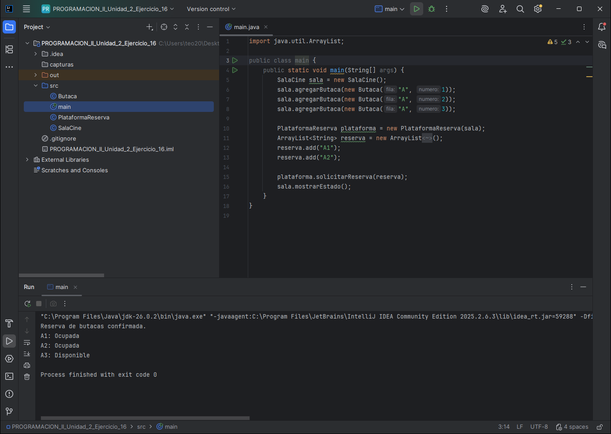

# PROGRAMACIÓN II — Unidad 2, Ejercicio 16: El Sistema de Reservas de Cine y Salas

Trabajo práctico de Programación II. Este repositorio contiene la resolución en Java del ejercicio 16 de la Unidad 2.

## Consigna

#### Contexto

Cuando un cliente compra entradas para el cine a través de una aplicación móvil, la plataforma se comunica con el objeto SalaCine para bloquear las locaciones físicas seleccionadas y emitir los tickets correspondientes.

#### Consigna

Establecer un flujo de comunicación donde un objeto PlataformaReserva envíe un mensaje a un objeto SalaCine solicitando la ocupación de butacas específicas.

#### Desarrollo requerido

- Definir la clase Butaca con fila, número y estado de disponibilidad.
- Crear la clase SalaCine que almacene una matriz o lista de butacas y provea un método bloquearButacas(List<String> codigosButacas).
- Implementar la clase PlataformaReserva que encapsule la lógica de interacción con el usuario y envíe la solicitud a la sala.
- En el método main, inicializar una sala con sus butacas, simular una reserva múltiple por parte de un usuario y mostrar por consola el estado actualizado de la sala.

## Estructura del repositorio

```
PROGRAMACION_II_Unidad_2_Ejercicio_16/
├── README.md
├── capturas/
│   └── consola.png
└── src/
    ├── Butaca.java
    ├── main.java   # clase con el método main
    ├── PlataformaReserva.java
    └── SalaCine.java
```

## Funcionamiento y lógica

El ejercicio simula la reserva de butacas en un cine: la plataforma de reservas le pide a la sala que bloquee un grupo de butacas.

### `Butaca`

Tiene `fila`, `numero` y `disponible`. Su código se arma uniendo fila y número (por ejemplo, "A1"). Toda butaca arranca disponible y con `bloquear()` pasa a ocupada.

### `SalaCine`

Guarda una lista (`ArrayList`) de butacas.

- **`bloquearButacas(lista de códigos)`:** trabaja en dos pasadas. Primero recorre todos los códigos pedidos y verifica que cada butaca exista y esté libre; si alguna no existe o ya está ocupada, informa el problema y no reserva ninguna. Solo cuando todas pasan la verificación, recorre de nuevo la lista y las bloquea, así la reserva es de todo o nada.
- **`mostrarEstado()`:** imprime cada butaca con su estado (Disponible u Ocupada).

### `PlataformaReserva`

Recibe la sala en el constructor y le delega la reserva con `solicitarReserva()`.

### `main`

Crea una sala con las butacas A1, A2 y A3 y la plataforma de reservas, y pide reservar A1 y A2. La reserva se confirma y el estado final muestra **A1 y A2 ocupadas** y **A3 disponible**.

## Ejecución

Captura de la consola de IntelliJ IDEA ejecutando el programa:



Salida obtenida:

```
Reserva de butacas confirmada.
A1: Ocupada
A2: Ocupada
A3: Disponible
```
